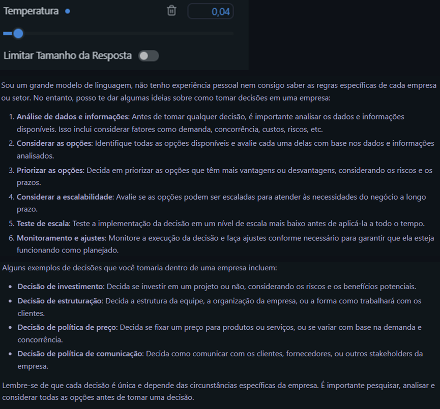
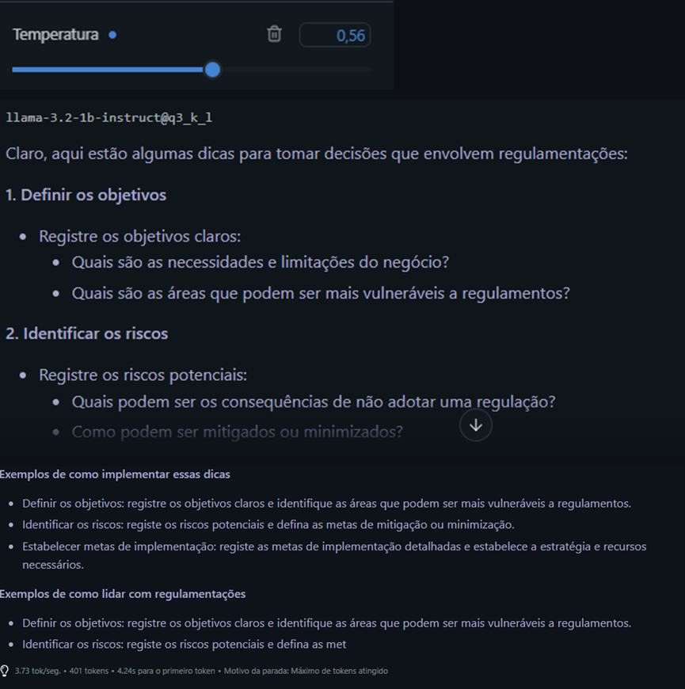

# Opta – Assistente de IA para pequenos negócios

Assistente virtual baseado em **LLM (Grande Modelo de Linguagem)** para apoiar **empreendedores e gestores de pequenas e médias empresas** na tomada de decisões do dia a dia.

Projeto da disciplina de **Inteligência Artificial** do curso de **Análise e Desenvolvimento de Sistemas – UEMA** (2025), feito em equipe.

## O problema
Pequenos negócios enfrentam decisões complexas todos os dias (vendas, equipe, estoque, marketing), mas raramente têm acesso a uma consultoria especializada.

## A solução
O **Opta** funciona como um **consultor virtual sob demanda**:
-  Analisa situações e sugere decisões (ex.: estratégias de vendas)
-  Dá dicas de gestão de equipe e liderança
-  Compara cenários (ex.: investir em marketing ou em estoque)

## Como foi construído
- **Ferramenta:** LM Studio, executando a IA **localmente**, no próprio computador, para proteger os dados da empresa
- **Modelo:** Llama 3.2 1B Instruct
- **Prompt-base:**
  - **Personalidade:** consultor profissional, respeitoso e colaborativo
  - **Regras:** respostas organizadas, linguagem acessível e foco em soluções práticas
  - **Restrição:** não dar conselhos ilegais nem conselhos financeiros sem validação

## Testes: o efeito da temperatura
A **temperatura** controla o quanto a IA é previsível ou criativa.

**Teste 1 – Temperatura 0,04 (baixa):** respostas diretas e lógicas, em passos numerados.

**Teste 2 – Temperatura 0,56 (média):** respostas mais detalhadas e criativas, com perguntas reflexivas e análise de riscos.

## O que descobrimos
- O Opta conseguiu manter o contexto e responder perguntas em sequência
- As respostas foram organizadas e fáceis de ler
- Pequenas mudanças na temperatura mudam muito o estilo das respostas

## Ética e limitações
- **Privacidade:** a execução local evita que dados da empresa saiam do computador
- **Vieses:** a IA pode reproduzir preconceitos presentes nos dados da internet
- **Precisão:** a IA pode errar com muita confiança
- **Conclusão:** o Opta é uma ferramenta de **apoio**, e a decisão final é sempre de uma pessoa

## Melhorias futuras
- Integrar com dados reais da empresa do usuário
- Ajustar o prompt para nichos de mercado específicos
- Criar formas de verificar as informações das respostas
